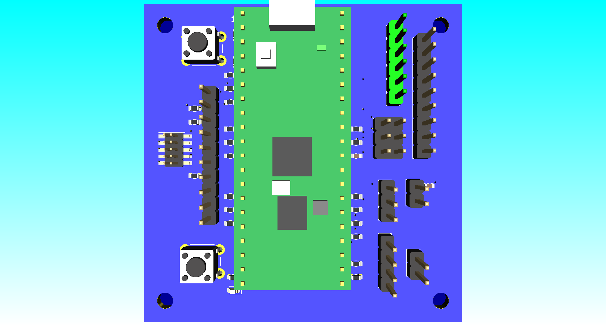
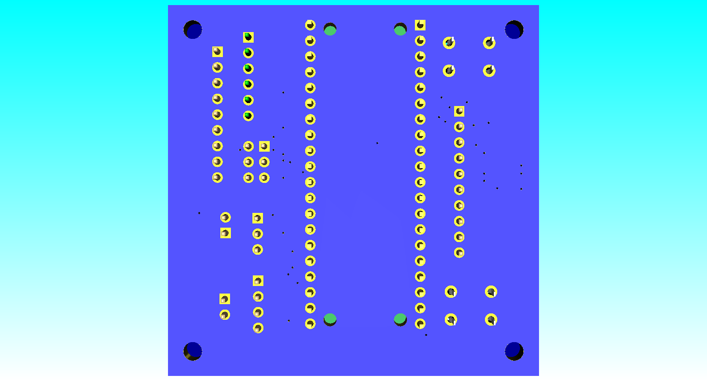

<p align="center"><picture><source media="(prefers-color-scheme: dark)" srcset="docs/images/logo_horizontal_dark.svg"></picture></p>

# D.UNI Probe v1

**Універсальний програматор і дебагер мікроконтролерів на Raspberry Pi Pico (RP2040)**

_Документ v1.0 · апаратна версія 1 · прошивка v1.1 · D.UNI Programmer v0.1 · листопад 2026_

📄 Документація: [онлайн / HTML](docs/index.html) · [схема PDF](hardware/DUNI_Probe_v1_schematic.pdf) · [PDF](docs/DUNI_Probe_v1.pdf) · [DOCX](docs/DUNI_Probe_v1.docx)




## 1. Призначення

**D.UNI Probe** — відкритий програматор і апаратний дебагер мікроконтролерів, зібраний на базі модуля **Raspberry Pi Pico (RP2040)**. Пристрій підключається до комп'ютера через USB і працює за стандартним протоколом **CMSIS-DAP v2**, тому його без додаткових драйверів «бачать» OpenOCD, pyOCD, probe-rs, Visual Studio Code (Cortex-Debug, ESP-IDF, Raspberry Pi Pico), STM32CubeIDE (через OpenOCD), Keil та інші середовища.

Одночасно з дебагером пристрій створює в системі **COM-порт (USB-UART міст)** — через нього прошиваються ESP32/ESP8266 і виводиться консоль цільової плати.

Основні сценарії використання:

- **Відладка** програм у VS Code або фірмовій IDE: точки зупинки, покрокове виконання, перегляд змінних і регістрів периферії.
- **Програмування** флеш-пам'яті: запис, читання, перевірка, стирання — з IDE, з командного рядка або з програми **D.UNI Programmer** для ПК.
- **Консоль UART** цільової плати через той самий USB-кабель.


### 1.1. Підтримувані контролери

| Сімейство | Інтерфейс | Програмування | Відладка | Стан |
|---|---|---|---|---|
| STM32 (усі серії Cortex-M) | SWD | так | так | реалізовано |
| Raspberry Pi RP2040 / RP2350 | SWD | так | так | реалізовано |
| Silicon Labs EFR32, Nordic nRF, Microchip SAM, TI MSPM0/CC13xx/CC26xx та інші Cortex-M | SWD | так | так | реалізовано (OpenOCD/pyOCD) |
| ESP32 (класичний) | UART + JTAG | так (UART) | так (JTAG) | реалізовано |
| ESP32-S2/S3/C3/C6/H2 | UART | так | через вбудований USB-JTAG чипа | реалізовано |
| ESP8266 | UART | так | GDBStub через UART (обмежено) | реалізовано (програмування) |
| AVR (ATmega/ATtiny), AVR UPDI | ISP / UPDI | — | — | апаратний резерв (J4, J5) |
| TI MSP430 | Spy-Bi-Wire | — | — | апаратний резерв (J6) |

> ⚠️ **Увага.** Версія 1 не має перетворювачів рівнів: підключайте **лише цілі з живленням 3.3 В**. Цілі на 5 В або 1.8 В можуть пошкодити Pico або цільову плату.


## 2. Технічні характеристики

| Параметр | Значення |
|---|---|
| Основа | Raspberry Pi Pico (RP2040, 2 × Cortex-M0+, 133 МГц, 2 МБ флешу) |
| Інтерфейс з ПК | USB 1.1 Full Speed (micro-USB на Pico): CMSIS-DAP v2 (WinUSB, без драйверів) + CDC COM-порт |
| USB VID:PID / ім'я | 2E8A:000C · «D.UNI Probe v1.1 (CMSIS-DAP)» |
| SWD | апаратно через PIO, до ~25 МГц (реально 1–10 МГц залежно від цілі й проводів) |
| JTAG | програмний (bit-bang), ~0.3–1 МГц |
| UART-міст | GP4 (TX) / GP5 (RX), швидкість задає ПК (до 921600 бод) |
| Керування ESP32 | EN (GP10) і IO0 (GP11), відкритий стік, емуляція DTR/RTS для esptool |
| Рівні сигналів | 3.3 В (без перетворювачів рівнів у версії 1) |
| Живлення | від USB (VBUS 5 В -> стабілізатор Pico -> 3.3 В) |
| Живлення цілі | перемичка JP1: 3.3 В від Pico, до ~200 мА |
| Вимірювання напруги цілі | дільник 1:2 на АЦП GP26, діапазон 0…6.6 В |
| Захист ліній | послідовні резистори 33 / 100 / 470 Ом на кожній сигнальній лінії |
| Індикація | LED Pico (GP25) — робота прошивки; D1 (GP15) — активність DAP |
| Кнопки | SW1 — скидання Pico (RUN); SW2 — ручне скидання цілі (nRESET) |
| Плата | 60 × 60 мм, 4 шари, 1.6 мм, 4 кріпильні отвори Ø3.0 мм (4 мм від країв) |
| Компоненти | SMD 0603 (резистори YAGEO, конденсатори Samsung), роз'єми THT 2.54 мм + Cortex 1.27 мм SMD |


## 3. Будова та принцип роботи

Програма на ПК (IDE, OpenOCD, D.UNI Programmer) надсилає команди CMSIS-DAP по USB. Прошивка на RP2040 перетворює їх на сигнали SWD або JTAG, а дані UART передає через окремий віртуальний COM-порт. Кожна сигнальна лінія виходить з Pico через послідовний резистор, який обмежує струм у разі помилкового підключення та гасить «дзвін» на довгих проводах.


### 3.1. Схема електрична принципова

Схема розділена на функціональні блоки (кожен у власній рамці). Усередині блоку елементи з'єднані провідниками, мітки використано лише для сигналів, що йдуть між блоками (від захисних резисторів до роз'ємів). Схему в PDF наведено у файлі `hardware/DUNI_Probe_v1_schematic.pdf`.

> ℹ️ Повна схема у форматі PDF: **`hardware/DUNI_Probe_v1_schematic.pdf`**.

| Блок | Елементи | Призначення |
|---|---|---|
| 1. Pico + захисні резистори | U1, R1–R17, R23, D1, SW1 | логіка пробника; резистори 33–470 Ом у кожній лінії; D1 — активність DAP |
| 2. Налагодження ARM | J1, J2, R18–R20, SW2 | SWD/JTAG; підтяжка nRESET і SWDIO, SWCLK до GND; кнопка скидання цілі |
| 3. ESP32 / ESP8266 | J3 | UART + EN + IO0 для автоматичного входу в завантажувач |
| 4. AVR | J4, J5 | ISP 6-pin та UPDI (резерв) |
| 5. MSP430 | J6 | Spy-Bi-Wire (резерв) |
| 6. AUX | J7 | 7 вільних GPIO + 3.3 В + GND |
| 7. Живлення цілі | JP1, C2 | подача 3.3 В на ціль, фільтрація VTREF |
| 8. Вимірювання VTREF | R21, R22, C1 | дільник 1:2 на АЦП GP26 |
| 9. Тест VBUS | J8 | контроль напруги USB |


### 3.2. Розподіл виводів Raspberry Pi Pico

| Pico | Сигнал | Резистор | Роз'єм | Призначення |
|---|---|---|---|---|
| GP2 | SWCLK / TCK | R1 33 Ом | J1-4, J2-2 | такт SWD / JTAG |
| GP3 | SWDIO / TMS | R2 33 Ом | J1-2, J2-3 | дані SWD / JTAG TMS |
| GP1 | nRESET | R3 33 Ом | J1-10, J2-6 | скидання цілі (відкритий стік) |
| GP6 | TDI | R4 33 Ом | J1-8, J2-5 | JTAG TDI |
| GP7 | TDO / SWO | R5 33 Ом | J1-6, J2-4 | JTAG TDO / SWO |
| GP8 | nTRST | R6 33 Ом | J2-7 | JTAG reset |
| GP4 / GP5 | UART TX / RX | R7 / R8 33 Ом | J2-9/10, J3-2/3 | USB-UART міст |
| GP10 / GP11 | ESP EN / IO0 | R9 / R10 100 Ом | J3-4 / J3-5 | автозавантаження ESP32 |
| GP12 | UPDI | R11 470 Ом | J5-2 | резерв |
| GP16–GP19 | ISP MISO/RST/SCK/MOSI | R12–R15 100 Ом | J4 | резерв |
| GP20 / GP21 | SBWTCK / SBWTDIO | R16 / R17 33 Ом | J6-3 / J6-2 | резерв |
| GP26 (ADC0) | VTREF_SENSE | R21/R22 дільник | — | вимір напруги цілі |
| GP15 | LED | R23 330 Ом | D1 | активність DAP |
| GP25 | LED Pico | — | — | heartbeat 1 Гц |
| GP0, 9, 13, 14, 22, 27, 28 | AUX0–AUX6 | — | J7-1…7 | резерв |


## 4. Друкована плата

Плата 60 × 60 мм, чотири шари міді. Модуль Pico встановлюється в центрі (на штирі або в панельки 2 × 20), роз'єми розміщено по боках: ліворуч — налагодження ARM (J1, J2) і кнопки, праворуч — ESP32, AVR, MSP430, AUX і живлення.


*3D-вигляд плати зверху*


*3D-вигляд плати знизу*


### 4.1. Шари та правила розведення

| Шар | Призначення |
|---|---|
| F.Cu (верх) | сигнальні доріжки, SMD-компоненти |
| In1.Cu | суцільний полігон GND (опорна площина для всіх сигналів) |
| In2.Cu | сигнальні доріжки (перетини) |
| B.Cu (низ) | сигнальні доріжки |

| Правило | Значення |
|---|---|
| Ширина сигнальних доріжок | 0.25 мм |
| +3V3, VTREF / VBUS | 0.4 мм / 0.5 мм |
| Перехідні отвори | 0.6 / 0.3 мм |
| Мінімальний зазор мідь–мідь | 0.2 мм |
| Мідь – край плати / мідь – отвір | 0.5 мм / 0.25 мм |
| Кути доріжок | лише 45° |
| Захисні резистори | впритул до виводів Pico, пін 1 з боку Pico |
| SMD-контакти GND | короткий відвід + перехідний отвір у площину In1 |


### 4.2. Розміщення роз'ємів

| Роз'єм | Тип | Положення | Сигнали (від виводу 1) |
|---|---|---|---|
| J1 | 2×5, 1.27 мм SMD (ARM Cortex Debug) | ліворуч | 1 VTREF · 2 SWDIO · 3 GND · 4 SWCLK · 5 GND · 6 SWO/TDO · 7 ключ · 8 TDI · 9 GND · 10 nRESET |
| J2 | 1×10, 2.54 мм | ліворуч від Pico | 1 VTREF · 2 SWCLK/TCK · 3 SWDIO/TMS · 4 TDO/SWO · 5 TDI · 6 nRESET · 7 nTRST · 8 GND · 9 UART TX · 10 UART RX |
| J3 | 1×6, 2.54 мм | праворуч угорі | 1 GND · 2 TX -> U0RXD · 3 RX <- U0TXD · 4 EN · 5 IO0 · 6 VTREF |
| J4 | 2×3, 2.54 мм (Atmel ISP) | праворуч | 1 MISO · 2 VTREF · 3 SCK · 4 MOSI · 5 RST · 6 GND |
| J5 | 1×3, 2.54 мм | праворуч | 1 VTREF · 2 UPDI · 3 GND |
| J6 | 1×4, 2.54 мм | праворуч унизу | 1 VTREF · 2 SBWTDIO · 3 SBWTCK · 4 GND |
| J7 | 1×9, 2.54 мм | праворуч | 1…7 AUX0…AUX6 · 8 +3V3 · 9 GND |
| JP1 | 1×2, 2.54 мм (перемичка) | праворуч | 1 +3V3 · 2 VTREF — замкнено: Pico живить ціль |
| J8 | 1×2, 2.54 мм | праворуч унизу | 1 VBUS · 2 GND |


### 4.3. Перелік елементів (BOM)

| Позначення | К-сть | Номінал | Part Number | Виробник | Корпус |
|---|---|---|---|---|---|
| U1 | 1 | Raspberry Pi Pico (RP2040) | SC0915 | Raspberry Pi Ltd | RPi_Pico_THT |
| R1, R2, R3, R4, R5, R6, R7, R8, R16, R17 | 10 | 33R | RC0603FR-0733RL | YAGEO | R_0603_1608Metric |
| R9, R10, R12, R13, R14, R15 | 6 | 100R | RC0603FR-07100RL | YAGEO | R_0603_1608Metric |
| R11 | 1 | 470R | RC0603FR-07470RL | YAGEO | R_0603_1608Metric |
| R18, R19, R20, R21, R22 | 5 | 10k | RC0603FR-0710KL | YAGEO | R_0603_1608Metric |
| R23 | 1 | 330R | RC0603FR-07330RL | YAGEO | R_0603_1608Metric |
| D1 | 1 | LED green | KT-0603G | Hubei KENTO Elec | LED_0603_1608Metric |
| C1 | 1 | 100nF | CL10B104KB8NNNC | Samsung Electro-Mechanics | C_0603_1608Metric |
| C2 | 1 | 10uF | CL10A106KP8NNNC | Samsung Electro-Mechanics | C_0603_1608Metric |
| SW1 | 1 | RESET Pico | TS665CJ | SHOU HAN | SW_PUSH_6mm |
| SW2 | 1 | TARGET RESET | TS665CJ | SHOU HAN | SW_PUSH_6mm |
| J1 | 1 | Cortex Debug 10p 1.27 | FTSH-105-01-L-DV-K | Samtec | PinHeader_2x05_P1.27mm_Vertical_SMD |
| J2 | 1 | SWD/JTAG/UART 2.54 | 2.54-1*40P (cut to length) | BOOMELE (Boom Precision Elec) | PinHeader_1x10_P2.54mm_Vertical |
| J3 | 1 | ESP32 UART boot | 2.54-1*40P (cut to length) | BOOMELE (Boom Precision Elec) | PinHeader_1x06_P2.54mm_Vertical |
| J4 | 1 | AVR ISP 2x3 | 2.54-2*3P | BOOMELE (Boom Precision Elec) | PinHeader_2x03_P2.54mm_Vertical |
| J5 | 1 | UPDI (AVR new) | 2.54-1*40P (cut to length) | BOOMELE (Boom Precision Elec) | PinHeader_1x03_P2.54mm_Vertical |
| J6 | 1 | MSP430 Spy-Bi-Wire | 2.54-1*40P (cut to length) | BOOMELE (Boom Precision Elec) | PinHeader_1x04_P2.54mm_Vertical |
| J7 | 1 | AUX reserve | 2.54-1*40P (cut to length) | BOOMELE (Boom Precision Elec) | PinHeader_1x09_P2.54mm_Vertical |
| JP1 | 1 | Target power 3V3 (jumper) | 2.54-1*40P (cut to length) | BOOMELE (Boom Precision Elec) | PinHeader_1x02_P2.54mm_Vertical |
| J8 | 1 | VBUS/GND test | 2.54-1*40P (cut to length) | BOOMELE (Boom Precision Elec) | PinHeader_1x02_P2.54mm_Vertical |

Посилання на даташити й магазини (LCSC / JLCPCB) записано в полях кожного компонента схеми та у файлі `hardware/BOM_v1.csv`.


## 5. Складання та перше ввімкнення

1. Запаяйте SMD-компоненти (0603), потім роз'єми та кнопки.
2. Встановіть Pico: напряму на плату або в панельки 2 × 20 (зручно для заміни).
3. Без підключеної цілі під'єднайте Pico до ПК кабелем micro-USB **з лініями даних**.
4. Затисніть кнопку **BOOTSEL** на Pico, підключіть USB, відпустіть — з'явиться диск `RPI-RP2`.
5. Скопіюйте на нього файл прошивки `firmware/bin/duni_probe_v1.uf2`. Pico перезавантажиться.
6. Перевірте: світлодіод на Pico блимає **1 раз на секунду**, у Диспетчері пристроїв є **«D.UNI Probe v1.1 (CMSIS-DAP)»** і новий **COM-порт**.

| Світлодіод на Pico (GP25) | Значення |
|---|---|
| блимає 1 раз/с | прошивка працює, USB підключено до ПК — норма |
| блимає 5 разів/с | прошивка працює, але ПК не розпізнав USB (кабель лише для живлення, зарядка) |
| не світиться / світиться постійно | прошивка не запустилась — прошийте UF2 повторно |


## 6. Підключення до цільової плати

1. Відключіть живлення цілі та USB пробника.
2. З'єднайте **GND** (обов'язково), **SWCLK**, **SWDIO**; бажано — **nRESET** і **VTREF**.
3. Якщо ціль не має власного живлення — встановіть перемичку **JP1** (Pico живить ціль 3.3 В, до ~200 мА). Якщо ціль живиться окремо — **зніміть JP1**.
4. Підключіть USB пробника, потім (за потреби) живлення цілі.

| Ціль | Що з'єднати |
|---|---|
| STM32 | SWCLK (PA14), SWDIO (PA13), GND, NRST -> nRESET, 3.3 В -> VTREF |
| RP2040 / Pico | SWCLK, SWDIO, GND (3 контакти DEBUG на торці Pico) |
| ESP32 (прошивка) | J3: TX -> U0RXD (GPIO3), RX <- U0TXD (GPIO1), EN, IO0, GND |
| ESP32 (JTAG) | J2: TCK -> IO13, TMS -> IO14, TDI -> IO12, TDO -> IO15, GND |
| ESP8266 | J3: TX -> RXD, RX <- TXD, **EN -> RST**, IO0 -> GPIO0, GND; на голому модулі CH_PD -> 3.3 В, GPIO15 -> GND, GPIO2 -> 3.3 В |


## 7. Робота у Visual Studio Code


### 7.1. Встановлення

| Розширення | ID | Навіщо |
|---|---|---|
| Raspberry Pi Pico | raspberry-pi.raspberry-pi-pico | Pico SDK, ARM GCC, CMake, OpenOCD, picotool |
| Cortex-Debug | marus25.cortex-debug | відладка ARM Cortex-M |
| C/C++ | ms-vscode.cpptools | IntelliSense |
| Serial Monitor | ms-vscode.vscode-serial-monitor | консоль COM-порту |
| ESP-IDF | espressif.esp-idf-extension | ESP32 |
| STM32Cube for VS Code (опц.) | stmicroelectronics.stm32-vscode-extension | проєкти STM32CubeMX |


### 7.2. Відладка RP2040

1. Створіть проєкт розширенням Raspberry Pi Pico (New C/C++ Project).
2. Скопіюйте `firmware/vscode-examples/rp2040-target/.vscode/launch.json` у папку `.vscode` проєкту.
3. Натисніть **F5**: прошивка запишеться, програма зупиниться на `main()`.

F5 — продовжити, F10 — крок, F11 — зайти у функцію, F9 — точка зупинки.


### 7.3. Відладка STM32

1. Створіть проєкт у STM32CubeMX (Toolchain: **CMake**).
2. Скопіюйте `firmware/vscode-examples/stm32-target/.vscode/` у проєкт.
3. У файлі `duni_stm32.cfg` змініть рядок `source [find target/stm32f1x.cfg]` на свою серію.
4. У `launch.json` вкажіть `executable`, `device`, `svdFile`. Натисніть **F5**.

```
adapter driver cmsis-dap
cmsis-dap vid_pid 0x2e8a 0x000c
transport select swd
adapter speed 4000
source [find target/stm32f1x.cfg]
# з підключеним NRST і потребою "connect under reset":
# reset_config srst_only srst_nogate connect_assert_srst
```


### 7.4. STM32CubeIDE

1. Run -> Debug Configurations -> вкладка **Debugger** -> Debug probe: **ST-LINK (OpenOCD)**.
2. Configuration script: **User Defined** -> `firmware/stm32/duni_stm32.cfg`.
3. Якщо OpenOCD від ST не знає адаптера cmsis-dap: запустіть зовнішній OpenOCD (`openocd -f duni_stm32.cfg`) і оберіть **Connect to remote GDB server**, `localhost:3333`.

> ℹ️ STM32CubeProgrammer працює лише з фірмовим ST-LINK. Для програмування STM32 через D.UNI використовуйте OpenOCD (`firmware/stm32/flash_stm32.bat`), pyOCD, probe-rs або програму D.UNI Programmer.


### 7.5. ESP32 / ESP8266

- **Прошивка:** `idf.py -p COMx flash monitor`, Arduino IDE або PlatformIO — пробник сам переводить ESP у режим завантаження (кнопки BOOT/EN не потрібні).
- **Відладка класичного ESP32:** JTAG через J2, налаштування в `firmware/vscode-examples/esp32-target`; OpenOCD: `-f interface/cmsis-dap.cfg -f target/esp32.cfg`.
- **ESP32-S3/C3/C6/H2** зручніше відлагоджувати через їхній вбудований USB-JTAG.
- **ESP8266:** відладка лише через GDBStub (UART), 1 апаратна точка зупинки.

> ⚠️ **Увага.** IO12 класичного ESP32 (JTAG TDI) задає напругу флешу при старті. Якщо з підключеним JTAG модуль не стартує — для модулів з флешем 3.3 В один раз виконайте `espefuse.py set_flash_voltage 3.3V` (незворотно).


## 8. Програма D.UNI Programmer (ПК)

Програма на Python з віконним інтерфейсом для операцій з флешем без IDE. Розташування — папка `software/`.

1. Встановіть Python 3.10+ (python.org, галочка «Add python.exe to PATH»).
2. Запустіть `run.bat`. Перший запуск триває 1–3 хв — встановлюються бібліотеки pyOCD і esptool.
3. Оберіть пробник і COM-порт угорі вікна, натисніть «Оновити».

| Вкладка | Можливості |
|---|---|
| ARM / SWD | підключення (halt / under-reset / attach), інформація про чип (ядро, STM32 DEV_ID, розмір флешу), карта пам'яті, запис .bin/.hex/.elf з перевіркою, читання у HEX-перегляд або файл, стирання чипа/діапазону, перевірка на чистоту, Reset/Halt/Run, встановлення CMSIS-Pack для будь-якого STM32 |
| ESP32 / UART | інформація про чип і флеш, запис до 4 файлів за адресами з перевіркою MD5, читання, стирання всього флешу або регіону |
| Пам'ять (HEX) | перегляд прочитаних даних, збереження у .bin / .hex |


## 9. Прошивка пробника

Прошивка базується на офіційній Raspberry Pi **Debugprobe** (ліцензія MIT) з доповненнями D.UNI. Код прошивки в цій версії документа не змінюється; вихідний код — у `firmware/source`.

| Доповнення D.UNI | Файли |
|---|---|
| Конфігурація пінів плати D.UNI | include/board_duni_config.h |
| JTAG-порт CMSIS-DAP (bit-bang), перемикання PIO SWD <-> GPIO JTAG | include/DAP_config.h, src/sw_dp_pio.c |
| Автозавантаження ESP32 (DTR/RTS -> EN/IO0), UART-міст без зупинки при DTR=0 | src/cdc_uart.c |
| Heartbeat LED (GP25), ініціалізація лінії nRESET | src/duni.c, src/duni.h |

Збирання: Pico SDK 2.3.0, `cmake -DPICO_BOARD=pico ..` -> `duni_probe_v1.uf2` (або Import Project у розширенні Raspberry Pi Pico).


## 10. Усунення несправностей

| Симптом | Що перевірити |
|---|---|
| «Error connecting DP: cannot read IDR» | GND; не переплутані SWCLK/SWDIO; живлення цілі; знизьте `adapter speed 1000` |
| Ціль спить або вимкнула SWD-піни | підключіть NRST, режим «under-reset» / `connect_assert_srst` |
| Пробник не видно в системі | інший USB-кабель (з даними), перепрошийте UF2, світлодіод має блимати 1 раз/с |
| Диск RPI-RP2 не з'являється | тримайте BOOTSEL до підключення USB |
| ESP32 не входить у завантажувач | проводи EN та IO0 (J3), спільна GND; для ESP8266 EN -> RST |
| Ціль не живиться | перемичка JP1, напруга на J8 (VBUS ≈ 5 В) |


## 11. Файли проєкту

| Папка | Вміст |
|---|---|
| hardware/ | схема (PDF), 3D-вигляд плати, перелік елементів (BOM), розпіновка. Файли KiCad буде опубліковано пізніше |
| firmware/ | прошивка: bin/duni_probe_v1.uf2, source/, stm32/, vscode-examples/ |
| software/ | програма D.UNI Programmer (Python) |
| docs/ | цей опис: index.html (сайт / GitHub Pages), PDF, DOCX, зображення |

Прошивка заснована на Raspberry Pi Debugprobe (MIT License, © Raspberry Pi Ltd). Під час публікації збережіть файл LICENSE з `firmware/source`.
